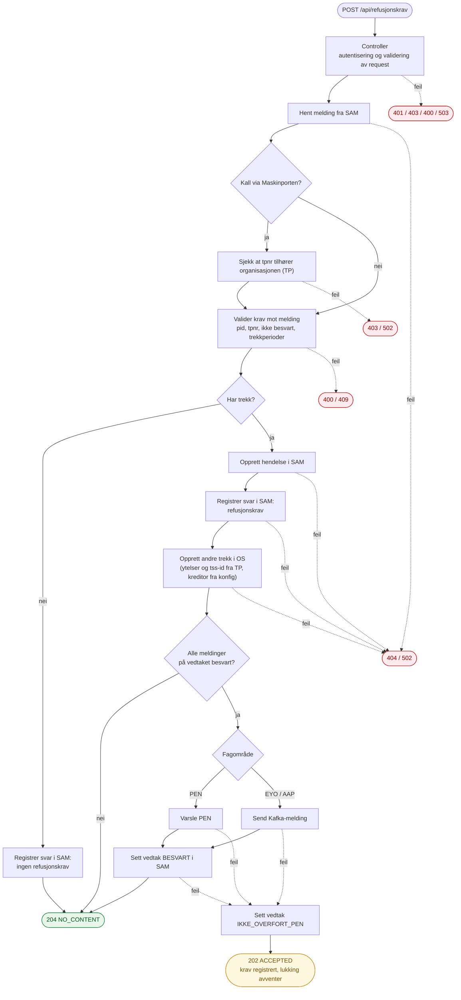

# Flyt: `POST /api/refusjonskrav`

Forenklet flytdiagram for branchen `feature/refusjonskrav_service`, fra `RefusjonskravController.opprett()`.

## Merknader

- Før controlleren kjører pinger et filter OS, PEN, SAM og TP. Er en av dem nede, gir kallet 503.
- Bare feil ved lukking av vedtak gir 202. Kravet er da lagret, men vedtaket er ikke lukket.
- Stiplede piler viser feil. Feilkodene er gruppert: 400 og 409 er valideringsfeil, 404 og 502 er feil mot SAM, TP eller OS.
